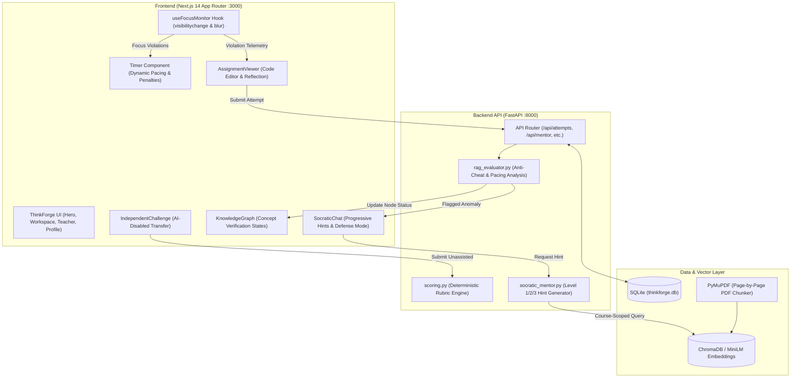

# ThinkForge — AI-Powered Learning for Independent Thinkers
### *(SocraticLMS Anti-Cheat & Dynamic Pacing Engine)*

> **“Don't replace thinking. Forge it.”**  
> *An AI learning mentor that trains you to need it less.*

ThinkForge is an educational platform and anti-cheat learning management system designed to eliminate AI-generated submission bypasses. Instead of acting as an answer vending machine, ThinkForge requires students to formulate their own logic first, delivers progressively faded Socratic hints grounded in teacher-provided course materials, triggers real-time **Socratic Interrogation Defenses** when pacing or focus anomalies occur, and measures authentic mastery through an AI-disabled transfer challenge.

---

## 🛠️ Complete Tech Stack & Where Each Technology is Used

Here is the exhaustive inventory of all technologies, frameworks, and libraries used across the application, including the exact files and functional modules where each is applied:

### 1. Frontend Technologies

| Technology | Version / Tool | Where It Is Used in the Codebase | Purpose & Responsibility |
| :--- | :--- | :--- | :--- |
| **Next.js (App Router)** | `^14.2.35` | `frontend/src/app/layout.tsx`<br>`frontend/src/app/page.tsx`<br>`frontend/next.config.mjs` | Primary web framework. Powers server-side metadata, layout nesting, asset routing, and rapid client-side transitions between Hero, Workspace, Teacher, and Profile views. |
| **React 18** | `^18.2.0` | `frontend/src/app/page.tsx`<br>`frontend/src/components/*`<br>`frontend/src/hooks/*` | Core UI library. Manages local component state, streaming message arrays, custom hooks, and dynamic re-rendering. |
| **TypeScript** | `^5.3.3` | `frontend/src/types/index.ts`<br>`frontend/tsconfig.json`<br>All `.ts` & `.tsx` files | Enforces strict compile-time types for domain models (`Assignment`, `KnowledgeNode`, `Citation`, `HintMessage`, `FocusState`). |
| **Tailwind CSS** | `^3.4.1` | `frontend/tailwind.config.js`<br>`frontend/src/app/globals.css`<br>All UI components | Utility-first styling engine. Implements the ThinkForge design system: Deep Navy (`#0F2E2E`), Forest Teal (`#113A35`, `#1F5F50`), Mint highlight badges, custom card radii (`rounded-2xl`, `rounded-3xl`), and soft drop shadows. |
| **Lucide React Icons** | `^0.354.0` | `frontend/src/components/*` | Consistent iconography across the platform: `ShieldAlert`, `ShieldCheck`, `Clock`, `Sparkles`, `BookOpen`, `Target`, `Network`, `Code`, and `ChevronRight`. |
| **Framer Motion** | `^11.0.8` | `frontend/package.json`<br>`frontend/src/components/*` | Smooth micro-interactions, alert pulses, and transitional animations. |
| **Custom React Hooks** | Custom | `frontend/src/hooks/useFocusMonitor.ts` | **Anti-Cheat Window Tracking**: Implements native browser event listeners (`visibilitychange`, `blur`, `focus`) to detect tab switches and penalize the pacing timer. |

---

### 2. Backend Technologies

| Technology | Version / Tool | Where It Is Used in the Codebase | Purpose & Responsibility |
| :--- | :--- | :--- | :--- |
| **Python** | `3.11` / `3.13` | `backend/app/*` | Core backend programming runtime. |
| **FastAPI** | `^0.110.0` | `backend/app/main.py`<br>`backend/app/api/routes.py` | Asynchronous high-performance REST API framework. Serves endpoints for assignments, PDF uploads, Socratic hints, defense verifications, and independence metrics. |
| **Uvicorn** | `^0.28.0` | `backend/app/main.py` | Lightning-fast ASGI web server running the FastAPI backend on `http://127.0.0.1:8000`. |
| **SQLAlchemy** | `^2.0.28` | `backend/app/models/models.py`<br>`backend/app/db/session.py`<br>`backend/app/db/init_db.py` | Object-Relational Mapper (ORM). Manages relational database models, foreign key relationships, cascading deletes, and data queries. |
| **SQLite** | SQLite 3 | `backend/data/thinkforge.db` | Embedded local relational database storing Courses, Indexed Documents, Assignments, Student Attempts, Revisions, Hint Histories, and Knowledge Nodes. |
| **Pydantic & Pydantic-Settings** | `^2.6.0` | `backend/app/schemas/schemas.py`<br>`backend/app/core/config.py` | Request/response data validation, strict schema serialization, and `.env` configuration management. |
| **Python Multipart** | `^0.0.9` | `backend/app/api/routes.py` | Handles `multipart/form-data` file uploads for teacher course PDFs. |

---

### 3. Document Ingestion, Embeddings & RAG

| Technology | Where It Is Used in the Codebase | Purpose & Responsibility |
| :--- | :--- | :--- |
| **PyMuPDF (`fitz`)** | `backend/app/services/pdf_extraction.py` | Extracts text page-by-page from uploaded PDF course materials while preserving explicit page numbers (`page: 12`). |
| **Text Chunking Engine** | `backend/app/services/chunking.py` | Slices extracted text into overlapping 400-word passages with 60-word overlap, attaching unique `chunk_id`, `course_id`, and `page` metadata. |
| **Sentence-Transformers (`all-MiniLM-L6-v2`)** | `backend/app/services/vector_store.py` | Generates normalized 384-dimensional dense vector embeddings for course text passages without requiring external cloud embedding APIs. |
| **ChromaDB** | `backend/app/services/vector_store.py` | Persistent local vector database storing embeddings and cosine distance indexing. Retrieves relevant course passages filtered by `course_id`. |
| **In-Memory Fallback Engine** | `backend/app/services/vector_store.py`<br>`frontend/src/lib/ragService.ts` | Deterministic course knowledge retrieval ensuring the entire platform runs smoothly even before weights download or when offline. |
| **Google GenAI SDK (Gemini)** | `backend/app/services/socratic_mentor.py` | Integration with Google Gemini (`GEMINI_MODEL=gemini-1.5-flash`) for synthesizing contextual Socratic questions grounded in retrieved course materials. Includes deterministic fallback if API key is omitted. |

---

### 4. Testing & Developer Tooling

| Tool | Where It Is Used in the Codebase | Purpose & Responsibility |
| :--- | :--- | :--- |
| **Pytest** | `backend/tests/test_api.py` | Automated testing suite validating backend health, chunking metadata preservation, hint level generation, anti-cheat pacing triggers, defense verification, and transfer scoring. |
| **HTTPX & FastAPI TestClient** | `backend/tests/test_api.py` | In-memory API client for executing end-to-end integration tests without spinning up a live network port. |
| **PowerShell & Windows cmd** | Workspace root | Cross-shell scripts and commands for running, building, and deploying the services. |

---

## 🗺️ Architectural Diagram



---

## 📂 Source Code Component Directory

### Frontend Components (`frontend/src/`)
* **`hooks/useFocusMonitor.ts`**: Custom React hook listening for `visibilitychange` and `blur`. Automatically updates violation counters, penalizes session timers, and passes violation telemetry to submissions.
* **`components/Timer.tsx`**: Dynamic countdown timer computed from problem length and complexity depth (`beginner`, `intermediate`, `advanced`). Subtracts 30s penalty per focus violation.
* **`components/SocraticChat.tsx`**: Progressive AI dialog interface providing Level 1 (Clarifying), Level 2 (Conceptual), and Level 3 (Scaffold) guidance. Automatically transforms into the **Socratic Interrogator** during defense challenges.
* **`components/KnowledgeGraph.tsx`**: Visual concept mastery map displaying real-time verification states (`Verified`, `Defense Required`, `Pending Defense`).
* **`components/AssignmentViewer.tsx`**: Left column workspace containing prompt instructions, expandable rubric, line-numbered code editor, initial attempt enforcement, and post-attempt reasoning reflection.
* **`components/DefenseBanner.tsx`**: High-priority alert banner signaling that an anti-cheat anomaly has occurred and conceptual defense is required.
* **`components/IndependentChallenge.tsx`**: Related transfer problem workspace where all AI hints and mentor calls are completely disabled.
* **`components/HeroSection.tsx`**: Faithful implementation of the ThinkForge brand hero section, typography, and interactive card preview.
* **`components/Header.tsx`**: Navigation bar with real-time focus lock monitor badge (`● Active (Focus Locked)` vs `⚠ Focus Violation Detected`) and pacing timer.
* **`components/TeacherDashboard.tsx`**: Course management suite for uploading text-based PDFs for RAG indexing and publishing assignments.
* **`components/IndependenceProfile.tsx`**: Transparent evidence audit trail tracking attempt-before-hint diligence, hint count, focus flags, and unassisted transfer scores.
* **`components/arena/AlgorithmArena.tsx`**: Fully playable educational mini-game featuring Dijkstra's Path Challenge, Build the Algorithm sequencing, and Edge Selection puzzles.
* **`components/arena/GraphCanvas.tsx`**: Interactive SVG graph visualization with dynamic node states, edge relaxations, and shortest-path trees.
* **`components/arena/DistanceTable.tsx`**: Real-time tabular tracking of tentative distances, predecessors, and finalized node statuses.
* **`lib/graphAlgorithms.ts`**: Pure mathematical Dijkstra implementation, challenge graph datasets (Easy, Medium, Hard), step validators, and puzzle generators.
* **`lib/ragService.ts`**: Resilient client-side API abstraction with automatic fallback.

### Backend Modules (`backend/app/`)
* **`main.py`**: FastAPI entrypoint with CORS middleware, startup database seeding, and health check routes.
* **`core/config.py`**: Configuration module loading `.env` variables (`GEMINI_API_KEY`, `CHROMA_PATH`, `DATABASE_URL`).
* **`models/models.py`**: SQLAlchemy schema defining `Course`, `Document`, `Assignment`, `Attempt`, `HintHistory`, `Reflection`, `TransferResult`, and `KnowledgeNode`.
* **`services/pdf_extraction.py`**: Extracts text page-by-page using PyMuPDF while preserving page numbers.
* **`services/chunking.py`**: 400-word sliding window chunker with 60-word overlap.
* **`services/vector_store.py`**: ChromaDB + SentenceTransformers `all-MiniLM-L6-v2` dense vector retrieval service.
* **`services/rag_evaluator.py`**: Anti-cheat evaluation engine detecting suspiciously fast submissions ($< 20\%$ target time), focus violations, or synthetic AI phrasing patterns.
* **`services/socratic_mentor.py`**: Progressive Level 1/2/3 Socratic hints with citations chips (`📖 Course Notes - Page 12 >`).
* **`services/scoring.py`**: Deterministic rubric scoring for AI-free transfer challenges.
* **`api/routes.py`**: REST API endpoints for all CRUD and interrogation operations.

---

## ⚡ Quickstart Guide (Windows PowerShell)

### 1. Launch the Backend Server
```powershell
cd backend
python -m venv .venv
.\.venv\Scripts\Activate.ps1
python -m pip install --upgrade pip
pip install -r requirements.txt
uvicorn app.main:app --reload --port 8000
```
* **API Health Check:** `http://127.0.0.1:8000/api/health`
* **Swagger API Console:** `http://127.0.0.1:8000/docs`

### 2. Launch the Frontend Server
```powershell
cd frontend
npm install
npm run dev
```
* **Web Application:** `http://localhost:3000`

### 3. Run Backend Test Suite
```powershell
cd backend
pytest tests/
```

---

## 🔒 Security, Privacy & Integrity Guarantees
1. **Zero Biometric / Invasive Surveillance:** ThinkForge does NOT use webcams, keystroke surveillance, or facial tracking. Integrity is protected via transparent window focus events and cognitive Socratic interrogation.
2. **API Key Isolation:** LLM provider secrets exist exclusively in `backend/.env` and are never exposed to the frontend or browser network logs.
3. **Course-Scoped RAG:** Document vector retrieval is strictly isolated to the student's enrolled course and assignment attachments.
4. **Resilient Fallback Mode:** The entire platform functions with deterministic educational fallbacks if external LLM keys are absent.
